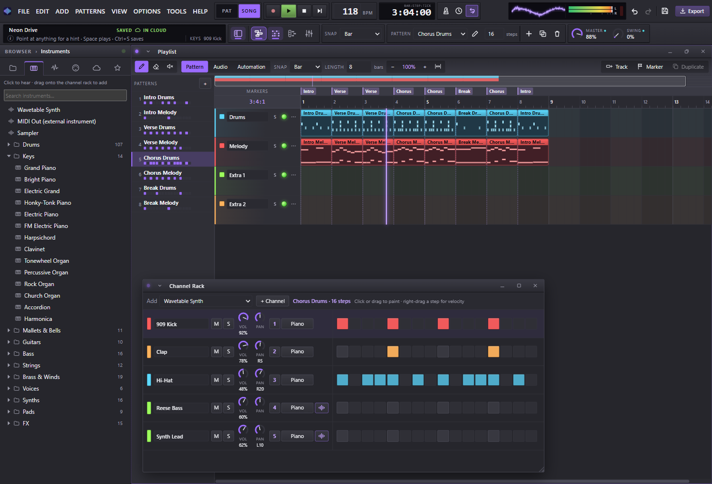

<h1 align="center">PulseGrid Studio</h1>

<p align="center">
  Free and open-source music production for Windows, Mac and the web.<br>
  Channel rack, piano roll, playlist and mixer, with 150 instruments and 14 effects built in.
</p>

<p align="center">
  <a href="https://github.com/BerdalYe/pulsegrid-studio/releases/latest"><b>Download</b></a>
  &nbsp;·&nbsp;
  <a href="https://pulsegridstudio.netlify.app/studio.html"><b>Open in the browser</b></a>
  &nbsp;·&nbsp;
  <a href="https://pulsegridstudio.netlify.app">Website</a>
  &nbsp;·&nbsp;
  <a href="LICENSE">GPL-3.0</a>
</p>

<p align="center">
  
</p>

## What it does

- **The workflow you know:** patterns in the channel rack, melodies in the piano roll, the song in the playlist, the mix in a 16-channel mixer with sends and 14 effects.
- **150 instruments, sorted by family:** recorded pianos, guitars, strings, brass, choirs and drum kits (in the desktop apps), the studio's own synths and wavetable synth, a drum machine and FX for builds and drops.
- **Your keyboard:** MIDI keyboards and pad controllers play the selected channel, and MIDI Out sends a channel to instruments in another program.
- **Your music is yours:** use it for anything, commercial releases included. PulseGrid claims no rights to what you make.
- **Cloud sync, if you want it:** sign in and choose which projects follow you between computers. Without an account nothing leaves your computer.
- **Export** to WAV and MP3.

## Install

- **Windows:** download `PulseGrid-Studio-Setup-<version>.msi` from the [latest release](https://github.com/BerdalYe/pulsegrid-studio/releases/latest) and run it. The installer isn't code-signed yet, so SmartScreen may warn: choose **More info → Run anyway**. The app updates itself.
- **Mac:** download `PulseGrid-Studio-<version>-mac.dmg`, open it and drag PulseGrid Studio into Applications. The app isn't signed with an Apple Developer certificate, so right-click it and choose **Open** the first time.
- **Browser:** [open the web studio](https://pulsegridstudio.netlify.app/studio.html). Nothing to install; the recorded instruments are only in the desktop apps.

## Build it yourself

You need [Node.js](https://nodejs.org) 22 or newer.

```sh
git clone https://github.com/BerdalYe/pulsegrid-studio.git
cd pulsegrid-studio
npm install
npm run app:dev      # the desktop app, reloading as you edit
npm run dev          # the web studio and the website, at http://localhost:5173
npm test             # the unit tests
npm run typecheck
```

Installers:

- **Windows:** `npm run release` writes `release/PulseGrid-Studio-Setup-<version>.msi`, and the website with its update feed into `dist/`.
- **Mac:** a `.dmg` can only be built on a Mac, so GitHub builds it. In the **Actions** tab choose **Build the Mac app → Run workflow**, and download **PulseGrid-Studio-mac** from the finished run.

### If you publish your own build

`package.json` → `pulsegrid` points at the official update feed, releases and cloud sync. Change these in a fork you
give to other people, so your builds don't update themselves to the official releases or sign in to the official cloud:

- `updateUrl`, `releaseUrl` and `siteUrl`: where your own releases and website live.
- `supabase.url` and `supabase.anonKey`: your own [Supabase](https://supabase.com) project. Create its tables with `supabase/schema.sql`.

## How the code is laid out

| Folder | What's in it |
| --- | --- |
| `src/audio` | The sound engine: sequencer, synth and SoundFont voices, effects, mixer graph, MIDI, WAV/MP3 export |
| `src/components` | The studio's windows and panels (React) |
| `src/state` | Project, session and settings stores (Zustand), undo |
| `src/presets` | The instrument list, synth presets and demo songs |
| `src/sync` | Optional cloud sync with Supabase |
| `src/site` | The website's script and styles; the pages are `index.html`, `legal.html`, `account.html` |
| `electron` | The desktop app: window, files, updates, sign-in |
| `assets/soundfonts` | The recorded instruments (GeneralUser GS) |

## Contributing

Bug reports, ideas and pull requests are welcome. See [CONTRIBUTING.md](CONTRIBUTING.md), or use **Help → Report a problem** in the app.

## Licence

PulseGrid Studio is free software: you can redistribute it and change it under the terms of the
[GNU General Public License](LICENSE), version 3 or (at your option) any later version. It comes with no warranty.

Copyright © 2026 Mathias Verdal and the PulseGrid Studio contributors.

The recorded instruments are [GeneralUser GS](https://www.schristiancollins.com) by S. Christian Collins,
under its own licence (`assets/soundfonts/LICENSE-GeneralUser-GS.txt`), which allows use in music and in software.
